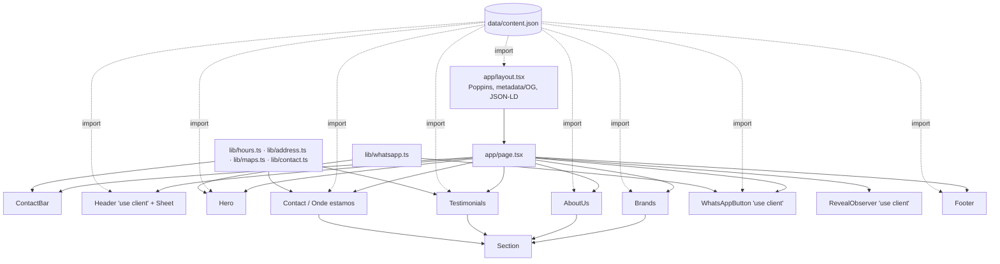

# Architecture

**Pattern:** landing page single-page estática (Next.js App Router, rota `/` prerenderizada).

## High-Level Structure

## Identified Patterns

### Seção = componente

`components/<kebab>.tsx`, default export, envolvida em `<Section id='...' tone='white|tint|blue'>` (`components/section.tsx`): fundo full-bleed, `py-16 md:py-24`, conteúdo em `.container` (1200 px) com `data-reveal`. `id` = âncora da navegação. Hero é a exceção (acima da dobra, não anima): `<section>` própria com fundo tint, grafismo do símbolo e foto LCP via ``; selo usa `formatRating(reviews.rating)` (`lib/rating.ts`), a mesma fonte da seção de avaliações.

### Conteúdo desacoplado em JSON

`import content from '@/data/content.json'`; tipos inferidos (`resolveJsonModule`). Imagens com caminho absoluto (`/assets/...`).

### Server por padrão

Client (`'use client'`) só: `Header` (sombra ao rolar + menu mobile em `Sheet`/Radix Dialog), `WhatsAppButton` (visibilidade por scroll/timer), `RevealObserver` (revela `[data-reveal]` abaixo da dobra uma vez; nada oculto sem JS ou com `prefers-reduced-motion`).

### Lógica pura em `lib/`

`lib/phone.ts` (`toInternationalDigits`: DDI 55, sem 0 de tronco), `lib/whatsapp.ts` (`buildWhatsAppUrl`), `lib/contact.ts` (`defaultWhatsAppUrl`, `phoneHref`, `shortHours` derivados do `content.json` — fonte única dos links de contato), `lib/hours.ts` (`formatHours`: texto do horário a partir de `hoursByDay` + `hoursLabels`), `lib/address.ts` (`formatAddress`), `lib/maps.ts` (`buildMapsSearchUrl`, `buildMapsEmbedUrl`), `lib/site.ts` (`siteUrl`), `lib/utils.ts` (`cn`). Testáveis sem DOM.

## Data Flow

### Navegação

Links `<a href='#id'>` gerados de `content.header.nav`. `ContactBar` (server) fica no fluxo, acima do `Header` `sticky`; nenhuma margem compensatória no `<main>`. Scroll suave e offset do header via CSS no `<html>`: `scroll-smooth scroll-pt-[calc(var(--header-h)+0.5rem)]` (altura do header só em `--header-h`, `app/globals.css`) + `data-scroll-behavior='smooth'`. IDs: `home`, `brands`, `about`, `testimonials`, `contact`.

### Contato

Fonte única: `content.contact.info.phone`.

- `Hero` → atalhos "Para sua empresa"/"Para sua casa": `buildWhatsAppUrl(phone, whatsappMessages.business | .home)`
- `ContactBar` → `defaultWhatsAppUrl`, `phoneHref` (`tel:+551932121177`), `shortHours`, Instagram
- `Header` CTA (desktop e `Sheet`) → `defaultWhatsAppUrl`
- `WhatsAppButton` → `defaultWhatsAppUrl`
- `Contact` ("Onde estamos") → `defaultWhatsAppUrl`, `phoneHref`, `buildMapsSearchUrl` / `buildMapsEmbedUrl`, redes
