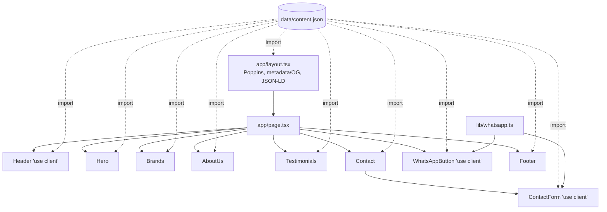

# Architecture

**Pattern:** landing page single-page estática (Next.js App Router, rota `/` prerenderizada).

## High-Level Structure

## Identified Patterns

### Seção = componente

`components/<kebab>.tsx`, default export, `<section id='...' className='w-full py-12 md:py-24 lg:py-32'>` + `
`. `id` = âncora da navegação.

### Conteúdo desacoplado em JSON

`import content from '@/data/content.json'`; tipos inferidos (`resolveJsonModule`). Imagens com caminho absoluto (`/assets/...`).

### Server por padrão

Client (`'use client'`) só: `Header` (scroll + menu mobile), `ContactForm` (state), `WhatsAppButton` (visibilidade por scroll/timer).

### Lógica pura em `lib/`

`lib/whatsapp.ts` (`buildWhatsAppUrl`, adiciona DDI 55), `lib/site.ts` (`siteUrl`), `lib/utils.ts` (`cn`). Testáveis sem DOM.

## Data Flow

### Navegação

Links `<a href='#id'>` gerados de `content.header.nav`. Scroll suave e offset do header fixo via CSS no `<html>`: `scroll-smooth scroll-pt-[90px]` + `data-scroll-behavior='smooth'`. IDs: `home`, `brands`, `about`, `testimonials`, `contact`.

### Contato

Fonte única: `content.contact.info.phone`.

- `WhatsAppButton` → `buildWhatsAppUrl(phone, content.contact.whatsappMessage)`
- `ContactForm` submit → `window.open(buildWhatsAppUrl(phone, texto com nome/email/mensagem))`
