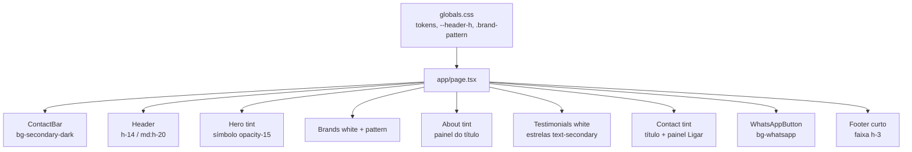

# Identidade visual da página — Design

**Spec**: `.specs/features/visual-identity/spec.md`
**Context**: `.specs/features/visual-identity/context.md`
**Status**: Draft

A página não ganha componente de seção novo nem chave nova em `data/content.json`. O que muda é onde cada token já existente é pintado, o tamanho do logo do header, o grafismo e o que o rodapé ainda renderiza.

`components/ui/` não se edita. Faixa de contato, botão flutuante e aceite de cookies não mudam de cor.

---

## Architecture Overview

A ordem em `app/page.tsx` fica: ContactBar, Header, Hero, Brands, AboutUs, Testimonials, Contact, WhatsAppButton, RevealObserver, Footer. O ritmo claro passa a ser hero tint, marcas branco, Sobre tint, avaliações branco, Onde estamos tint.

Sobre e Onde estamos deixam de ser um retângulo `tone='blue'` (`bg-secondary-dark` na seção inteira). O título grande vai para um painel `bg-secondary` dentro do `.container`. O corpo fica no tint, com texto `foreground` e ícone `secondary-dark`. Texto pequeno branco continua só em três fundos `#1f6aa0`: a faixa de contato, o corpo do rodapé e o painel de Ligar / Como chegar.

O pattern do símbolo entra uma vez, como camada da `Section` de marcas, fora do `data-reveal`. O símbolo cortado do hero continua a mesma `<Image>`, só mais opaca. `--header-h` continua sendo a única altura do header sticky, do `scroll-pt` e da página de privacidade; o valor muda num override `md`.



---

## Code Reuse Analysis

### Existing Components to Leverage

| Peça                                      | Onde                                                    | Como usar                                                                                                                                                                                              |
| ----------------------------------------- | ------------------------------------------------------- | ------------------------------------------------------------------------------------------------------------------------------------------------------------------------------------------------------ |
| `Section`                                 | `components/section.tsx`                                | Continua dona do fundo full-bleed, do `py-16 md:py-24` e do `.container` com `data-reveal`. Perde o tom `blue`. Ganha `pattern` só para marcas.                                                        |
| Tokens em `@theme`                        | `app/globals.css`                                       | `#2983c2`, `#1f6aa0`, `#d52825`, `#b3211f`, `#eaf3fa`, `#25d366`, `#1ebe5d` permanecem. Sai só `--color-rating`.                                                                                       |
| `--header-h`                              | `:root` em `app/globals.css`                            | `header.tsx` (`h-(--header-h)`), `app/layout.tsx` (`scroll-pt-[calc(var(--header-h)+0.5rem)]`) e `app/privacidade/page.tsx` (`h-(--header-h)`) já leem a variável. Nenhum deles ganha altura em pixel. |
| Marquee de marcas                         | `.brands-grid` / `.brands-marquee` em `app/globals.css` | Não muda. O pattern é outra classe, estática, no mesmo arquivo.                                                                                                                                        |
| `buildWhatsAppUrl` / `defaultWhatsAppUrl` | `lib/whatsapp.ts`, `lib/contact.ts`                     | Header, hero, faixa, Onde estamos e flutuante continuam com esses helpers. O rodapé deixa de importá-los.                                                                                              |
| Copy                                      | `data/content.json`                                     | Nenhuma chave de marketing é reescrita. O rodapé para de ler `contact.info` e `contact.social`; a seção e a faixa continuam lendo.                                                                     |
| Kit PNG                                   | `public/brand/symbol.png` e logos                       | Sem arquivo novo. Hero usa o PNG como está. O pattern usa o alfa do mesmo PNG como máscara.                                                                                                            |

### Integration Points

| Sistema                              | Ligação                                                                                                                                                 |
| ------------------------------------ | ------------------------------------------------------------------------------------------------------------------------------------------------------- |
| Paleta (`tests/palette.test.ts`)     | Continua varrendo `app/` e `components/` fora de `components/ui/`. Hex fora do `@theme` e cor de família Tailwind seguem proibidos.                     |
| Contraste de texto pequeno           | O teste que exige branco ≥ 4,5:1 em `secondary-dark`, `primary` e `primary-dark` não muda. `#2983c2` com branco fica em 4,10:1 e não entra nessa lista. |
| `RevealObserver`                     | Só anima `[data-reveal]`. O pattern não leva `data-reveal`, então não translada.                                                                        |
| Medição (`tests/conversion.test.ts`) | `header`, `contact-bar`, `hero`, `onde-estamos` e `flutuante` ficam. `rodape` sai com os links.                                                         |
| Página de privacidade                | Herda `--header-h`. Não tem valor próprio.                                                                                                              |

### Área frágil

`content.json` não tem schema runtime (`CONCERNS.md`). Esta feature não adiciona nem renomeia chave. `tests/content.test.ts` permanece como está. `components/ui/sheet.tsx` tem `data-[state=open]:bg-secondary` no botão de fechar do vendor; isso não é painel de título e não se edita.

---

## Components

### Tokens e altura do header

- **Purpose**: Tirar o amarelo e fazer o header caber no logo de 56 px e no de 80 px com uma só variável.
- **Location**: `app/globals.css`
- **Interfaces**: custom properties já consumidas; nenhum export novo.
- **Dependencies**: Tailwind 4 (`@theme`). A escala padrão já emite `opacity-15` (o projeto usa `opacity-10` e `opacity-100` dessa mesma escala).
- **Reuses**: bloco `:root` atual dentro de `@layer base`.

Mudanças no `@theme`:

- Apagar `--color-rating: #eab308` e o comentário que trata o amarelo como exceção de AD-016.
- Manter `--color-whatsapp: #25d366` e `--color-whatsapp-dark: #1ebe5d`. O comentário passa a dizer que o verde é só do botão flutuante.
- Não declarar hex novo fora do `@theme`. A guarda de paleta falha se isso acontecer.

`--header-h`, ainda dentro de `@layer base`:

| Viewport                    | Valor            | O que cabe                                      |
| --------------------------- | ---------------- | ----------------------------------------------- |
| base (`:root`)              | `4.5rem` (72 px) | logo `h-14` (56 px) com 8 px acima e abaixo     |
| `@media (min-width: 768px)` | `7rem` (112 px)  | logo `md:h-20` (80 px) com 16 px acima e abaixo |

São duas declarações da mesma variável, e só essas duas. O override não repete o resto do `:root`. O header não ganha `md:h-*` nem `h-[Npx]`. `scroll-pt` continua `calc(var(--header-h) + 0.5rem)`.

`.brand-pattern` (ao lado das regras do marquee, sem hex, sem `animation`, sem `transform`):

```css
.brand-pattern {
  mask-image: url('/brand/symbol.png');
  mask-repeat: repeat;
  mask-size: 8rem;
  mask-position: center;
  -webkit-mask-image: url('/brand/symbol.png');
  -webkit-mask-repeat: repeat;
  -webkit-mask-size: 8rem;
  -webkit-mask-position: center;
}
```

A cor é a classe `bg-secondary` no elemento, não um hex nesta regra. O alfa do PNG (color type 6, já exigido por `tests/brand.test.ts`) vira a máscara: o tile repetido sai inteiro em `#2983c2`, sem o vermelho do arquivo. A regra fica fora de `@media (prefers-reduced-motion)`. Com motion reduzido o pattern continua visível e parado.

### Section

- **Purpose**: Fundo da seção e, só em marcas, a camada do pattern atrás do conteúdo.
- **Location**: `components/section.tsx`
- **Interfaces**:
  - `tone?: 'white' | 'tint'` — default `'white'`. O tom `blue` sai do mapa `TONES`. Quem precisar de `#1f6aa0` pinta o próprio painel (`ContactBar`, `Footer`, painel de Ligar).
  - `pattern?: boolean` — default `false`. Só `Brands` passa `true`.
- **Dependencies**: `cn`, classe `.brand-pattern`.
- **Reuses**: markup atual da `<section>` e do `.container`.

Com `pattern`:

- A `<section>` ganha `relative overflow-hidden`. Sem pattern, não ganha: sombra de card e anel de foco das outras seções não devem ser cortados.
- Primeiro filho: `<div aria-hidden className='brand-pattern pointer-events-none absolute inset-0 z-0 bg-secondary opacity-10' />`.
- O `.container` ganha `relative z-10` só nesse caso. Sem isso, o absoluto com `z-auto` pinta por cima do fluxo e cobre título e logos.
- O pattern não leva `data-reveal`. O `data-reveal=''` continua no `.container`.

`overflow-hidden` mais `inset-0` seguram o tile em 320 px. `opacity-10` no tile é o contraste baixo: o título `text-secondary` e os logos ficam no `z-10`, em cor cheia. Se na inspeção o tile competir com o logo, o ajuste permitido é descer para `opacity-5`, sem reabrir a spec. O valor travado para o teste é `opacity-10`.

### Header

- **Purpose**: Logo no mínimo do manual a partir de `md`, folga de 1,25 rem, menu na cor de texto.
- **Location**: `components/header.tsx`
- **Interfaces**: nenhuma prop nova. Continua client por causa do scroll e do `Sheet`.
- **Dependencies**: `content.header.brand`, `defaultWhatsAppUrl`, `--header-h`.
- **Reuses**: `WhatsAppCta` com `bg-primary` / `hover:bg-primary-dark` / `data-track-location='header'`.

| Hoje                                                                 | Passa a                                                        |
| -------------------------------------------------------------------- | -------------------------------------------------------------- |
| `h-11 w-auto md:h-12` no logo                                        | `h-14 w-auto md:h-20`                                          |
| `gap-4` na linha do `.container`                                     | `gap-5` (1,25 rem, piso da spec; `justify-between` só aumenta) |
| `text-gray-700` no link do menu, no botão do menu e no link do sheet | `text-foreground`                                              |
| hover `text-secondary-dark`                                          | igual                                                          |

`alt={brand}` permanece (`brand` é `content.header.brand`). `width={594}` e `height={180}` permanecem; a altura renderizada é a classe. O CTA não usa `bg-whatsapp`.

Em 320 px a conta fecha sem rolagem horizontal: logo ~185 px (594/180 × 56) + `gap-5` 20 px + botão `size-11` 44 px + padding do container 32 px ≈ 281 px.

### Hero

- **Purpose**: Símbolo cortado visível, mesma foto, estrela na cor da marca.
- **Location**: `components/hero.tsx`
- **Interfaces**: nenhuma.
- **Dependencies**: `/brand/symbol.png`, WebP atuais, `formatRating`.
- **Reuses**: a `<Image>` decorativa e o `` do LCP. Não entra máscara, não entra camada sobre a foto.

A classe do símbolo troca `opacity-10` por `opacity-15` (15%, o degrau Tailwind acima de 10% e o mais perto de 16%). Permanecem `alt=''`, `aria-hidden`, `pointer-events-none`, `absolute -right-24 -bottom-32 w-md lg:-right-16 lg:w-xl` e `overflow-hidden` na `<section>`. O PNG continua nas duas cores oficiais: aqui ele é a marca cortada, uma vez, não o pattern. Não animar.

A estrela do selo troca `text-rating` por `text-secondary`. Os dois CTAs continuam `bg-primary` e `border-primary`, com `data-track-location='hero'`. A classe da foto (`aspect-3/2 w-full rounded-2xl object-cover shadow-lg`) e os três WebP não mudam.

### Brands

- **Purpose**: Pattern do símbolo, uma vez, atrás do carrossel.
- **Location**: `components/brands.tsx`
- **Interfaces**: passa `tone='white'` e `pattern` para `Section`. O default já é white; o tom explícito deixa o ritmo legível no fonte e no teste.
- **Dependencies**: `.brand-pattern` via `Section`.
- **Reuses**: badge, título, `brands-grid`, `brands-marquee`, `animate-marquee`. SP-01 não muda.

O componente não desenha o tile. Não referencia `symbol.png` direto. Badge (`bg-secondary-bg text-secondary-dark`) e título (`text-h2 text-secondary`) ficam no container, acima do pattern.

### AboutUs

- **Purpose**: Corpo em tint e título grande em branco sobre `#2983c2`.
- **Location**: `components/about-us.tsx`
- **Interfaces**: `<Section id='about' tone='tint'>`. Sem `pattern`.
- **Dependencies**: `content.about`, `content.features`.
- **Reuses**: grid dos diferenciais, sem `border`, sem `shadow-`, sem `bg-white/5`.

Ordem, de cima para baixo, tudo dentro do container:

1. Badge no tint: `rounded-lg bg-white px-3 py-1 text-sm text-secondary-dark`. Texto pequeno não entra no painel azul (branco em `#2983c2` é 4,10:1).
2. Painel só do título: `rounded-2xl bg-secondary px-6 py-4 text-white`, com o `h2` em `text-h2 font-bold text-balance`. `text-h2` começa em 1,75 rem (28 px), acima do corte de texto grande.
3. Descrição: `text-foreground` (sai `text-white/90`).
4. Diferenciais: ícone `CheckCircle` em `text-secondary-dark`; `h3` e parágrafo em `text-foreground` (sai `text-white` / `text-white/90`).

O painel é markup local, não um componente. Não é full-bleed: margem negativa brigaria com o container e com a meta de 320 px sem rolagem. O arquivo não contém `tone='blue'`, `bg-secondary-dark` nem `brand-pattern`.

### Testimonials

- **Purpose**: Faixa branca do ritmo e estrela em `#2983c2`.
- **Location**: `components/testimonials.tsx`
- **Interfaces**: `<Section id='testimonials' tone='white'>`. Sem `pattern`.
- **Dependencies**: `formatRating`, `content.reviews`.
- **Reuses**: CTA outline `border-primary` com `min-h-11`, grade condicional `items.length > 0`, cards `border bg-white shadow-xs`.

`Stars` troca `text-rating` por `text-secondary`. O badge hoje é `bg-white` em seção tint; na seção branca ele some. Passa a `bg-secondary-bg text-secondary-dark`, o mesmo chip de marcas. Nota `text-secondary` e summary `text-muted-foreground` ficam.

### Contact

- **Purpose**: Onde estamos em tint, título no azul oficial, Ligar e Como chegar no azul de apoio.
- **Location**: `components/contact.tsx`
- **Interfaces**: `<Section id='contact' tone='tint'>`. Sem `pattern`.
- **Dependencies**: `formatAddress`, `formatHours`, `defaultWhatsAppUrl`, `phoneHref`, `buildMapsSearchUrl`, `buildMapsEmbedUrl`, `content.contact`.
- **Reuses**: grid com o mapa, CTAs com `min-h-11`, `data-track-location='onde-estamos'`.

Corpo, no tint, com texto `foreground` e ícones `MapPin`, `Phone`, `Mail`, `Clock` em `text-secondary-dark` (sai `text-white` / `text-white/90`):

1. Badge: `bg-white text-secondary-dark` (sai `bg-white/15 text-white`).
2. O mesmo painel de Sobre, `rounded-2xl bg-secondary px-6 py-4 text-white`, só em volta do `h2` `text-h2 font-bold`.
3. Descrição e os quatro blocos (endereço, telefone, e-mail, horário) em `text-foreground`.
4. WhatsApp da seção, solto no tint: `bg-primary`, `hover:bg-primary-dark`, ícone `FaWhatsapp` sem classe `bg-whatsapp` / `text-whatsapp`.
5. Painel `rounded-2xl bg-secondary-dark p-3` com só Ligar e Como chegar. Os dois continuam no `OUTLINE` atual: `border-2 border-white`, `text-white`, `hover:bg-white/10`, `min-h-11`. Texto pequeno branco não vai para `#2983c2`.
6. Facebook e Instagram fora desse painel, no tint: `border-2 border-secondary-dark text-secondary-dark bg-white hover:bg-secondary-bg`. A spec pede ícone `secondary-dark` para as redes. O `OUTLINE` branco não serve mais neles.
7. Iframe: `bg-white/10` vira `bg-white`. O translúcido existia para o fundo azul.

No fonte, o índice de `content.contact.actions.whatsapp` fica antes de `bg-secondary-dark`; Ligar e Como chegar ficam depois. O arquivo não contém `tone='blue'` nem `brand-pattern`.

### Footer

- **Purpose**: Rodapé curto no azul de apoio, com a faixa de assinatura em 12 px.
- **Location**: `components/footer.tsx`
- **Interfaces**: nenhuma.
- **Dependencies**: `content.footer.logoAlt`, `content.footer.rights`, `content.footer.privacy`. Ano com `new Date().getFullYear()`, como hoje.
- **Reuses**: `bg-secondary-dark`, `.container`, `/brand/logo-horizontal-white.png`, link `/privacidade`.

Saem do arquivo: `formatAddress`, `formatHours`, `defaultWhatsAppUrl`, `phoneHref`, `mailto:`, `social.facebook`, `social.instagram`, ícones `Clock` / `Mail` / `MapPin` / `Phone` / `FaFacebookF` / `FaInstagram` / `FaWhatsapp`, a constante `LINK`, `cn`, e qualquer `data-track-location`. Não apagar essas chaves do JSON: a faixa e Onde estamos ainda as usam.

Ficam, nesta ordem:

1. Logo branco em `<a href='#home'>`, `alt={content.footer.logoAlt}`, classe atual `h-11 w-auto md:h-12`. Os 80 px são requisito do header (VI-03). Repetir essa altura aqui desfaz o rodapé curto.
2. Linha de copyright e privacidade, `text-sm text-white`, com `© {year} {content.footer.rights}` e `<a href='/privacidade'>`. Sem CNPJ. Branco a 80% sobre `#1f6aa0` cai para ~4,3:1.
3. Faixa `flex h-3` (`aria-hidden`, sem texto e sem logo): metade `bg-secondary`, metade `bg-primary`. Sai `h-1`.

O miolo desce de `gap-10 py-12 md:py-16` para `gap-6 py-10 md:py-12`. O logo branco sobre `#1f6aa0` segue válido; o texto pequeno da linha de baixo também (5,79:1).

### O que não muda de implementação

| Peça                                                         | Por quê                                                                                                                                 |
| ------------------------------------------------------------ | --------------------------------------------------------------------------------------------------------------------------------------- |
| `components/whatsapp-button.tsx`                             | Já é `bg-whatsapp` / `hover:bg-whatsapp-dark`, ícone branco, `data-track-location='flutuante'`. Único arquivo com essas classes de cor. |
| `components/contact-bar.tsx`                                 | Já é `bg-secondary-dark`, links `min-h-11`, sem `bg-secondary`.                                                                         |
| `components/cookie-banner.tsx`                               | Aceite já é `bg-primary`.                                                                                                               |
| `app/layout.tsx`, `app/privacidade/page.tsx`, `app/page.tsx` | Já consomem `--header-h` ou a ordem certa. A privacidade não ganha altura própria.                                                      |
| `components/ui/*`                                            | Vendor.                                                                                                                                 |
| `data/content.json`                                          | Fora do escopo visual.                                                                                                                  |
| `lib/*`                                                      | Nenhum helper novo. O rodapé apenas deixa de importar os de contato.                                                                    |

---

## Data Models

Não há modelo novo. `content.json` não muda.

O rodapé deixa de ler `content.contact`. Quem continua lendo:

| Dado                                                 | Leitor                                                     |
| ---------------------------------------------------- | ---------------------------------------------------------- |
| `contact.info` (endereço, horário, telefone, e-mail) | `Contact`, `ContactBar` (telefone e horário curto)         |
| `contact.social`                                     | `Contact` (Facebook e Instagram); `ContactBar` (Instagram) |
| `footer.logoAlt`, `footer.rights`, `footer.privacy`  | `Footer`                                                   |
| `header.brand`                                       | alt do logo do header                                      |

---

## Error Handling Strategy

Não há erro de rede nem de formulário nesta feature. Os limites são de contraste e de caixa.

| Situação                                                            | Tratamento                                                                                                                                     | O que o visitante vê                                 |
| ------------------------------------------------------------------- | ---------------------------------------------------------------------------------------------------------------------------------------------- | ---------------------------------------------------- |
| Texto branco abaixo de 24 px (ou de 18,66 px em negrito) sobre azul | Fundo `#1f6aa0` (`bg-secondary-dark`): faixa, rodapé, painel de Ligar / Como chegar. O painel do título não recebe badge, descrição nem botão. | Texto pequeno branco só no azul de apoio             |
| Viewport 320 px                                                     | Logo `h-14`, pattern `inset-0` com `overflow-hidden`, símbolo do hero já cortado por `overflow-hidden`                                         | Sem rolagem horizontal                               |
| `prefers-reduced-motion`                                            | `.brand-pattern` sem animação e fora do `data-reveal`. Marquee já cai no grid (SP-01). Símbolo do hero sem animação nova                       | Pattern parado; grid de marcas no lugar do carrossel |
| Privacidade                                                         | `h-(--header-h)`, sem rem próprio                                                                                                              | O header simples acompanha 4,5 rem / 7 rem           |
| `symbol.png` ausente                                                | Já coberto por `tests/brand.test.ts`. Hero e pattern apontam para o mesmo arquivo                                                              | —                                                    |

---

## Tech Decisions

| Decisão                      | Escolha                                                                         | Por quê                                                                                                                                                                                                                                           |
| ---------------------------- | ------------------------------------------------------------------------------- | ------------------------------------------------------------------------------------------------------------------------------------------------------------------------------------------------------------------------------------------------- |
| Painel do título             | `rounded-2xl bg-secondary px-6 py-4 text-white` dentro do container, só no `h2` | A spec permite faixa ou painel. Full-bleed com margem negativa fura o container e o limite de 320 px. Duas cópias da classe, sem componente novo.                                                                                                 |
| Tom `blue` da `Section`      | Removido do tipo                                                                | Sobre e Onde estamos eram os únicos usos. Deixar o tom no mapa facilita recriar o retângulo `#1f6aa0`.                                                                                                                                            |
| Ligar / Como chegar          | Painel `bg-secondary-dark` próprio, WhatsApp `bg-primary` fora dele             | Texto pequeno branco falha em `#2983c2` (4,10:1) e passa em `#1f6aa0` (5,79:1). O vermelho continua a ação da marca, no tint.                                                                                                                     |
| Redes de Onde estamos        | `text-secondary-dark` no tint, não no painel escuro                             | A spec pede ícone `secondary-dark` para as redes. Branco sobre azul fica reservado a Ligar e Como chegar.                                                                                                                                         |
| Opacidade do símbolo no hero | `opacity-15`                                                                    | 15% é o degrau da escala acima de `opacity-10` e o mais perto de 16%. `opacity-20` compete mais com o título. Sem valor arbitrário.                                                                                                               |
| Pattern                      | Máscara do `symbol.png` + `bg-secondary` + `opacity-10`, tile `8rem`            | O PNG é azul e vermelho. Máscara no alfa entrega o tile só em `#2983c2`, sem hex fora do `@theme` e sem PNG novo (B-001). `opacity-10` aqui é contraste de textura, não a opacidade do hero.                                                      |
| Onde vive o pattern          | Prop `pattern` na `Section`, irmão anterior do `.container`                     | De dentro do container o tile não cobre a seção, e dentro do `data-reveal` ele translada.                                                                                                                                                         |
| Altura do header             | `4.5rem` / `7rem` na mesma variável, dentro de `@layer base`                    | 7 rem é o “em torno de 7 rem” do contexto para o logo de 80 px. A base cabe no logo de 56 px sem repetir os 7 rem no celular, onde a faixa de contato já consome a primeira tela. Um único lugar evita `md:h-28` competindo com `h-(--header-h)`. |
| Folga do logo                | `gap-5` na linha do header                                                      | 1,25 rem é o piso (25% de 80 px). `justify-between` não reduz esse piso.                                                                                                                                                                          |
| Logo do rodapé               | Mantém `h-11 md:h-12`                                                           | VI-03 fixa 80 px no header. O rodapé curto não leva um segundo logo nessa altura.                                                                                                                                                                 |
| Faixa de assinatura          | `h-3`, metade `bg-secondary`, metade `bg-primary`                               | 12 px, sem texto. `h-3` é 0,75 rem.                                                                                                                                                                                                               |
| Estrelas                     | `text-secondary`                                                                | Ícone, não texto pequeno. O token `rating` sai.                                                                                                                                                                                                   |
| Menu                         | `text-foreground`                                                               | `text-gray-700` é neutro permitido pela guarda de paleta. O teste do header precisa proibir a classe na mão.                                                                                                                                      |
| Avaliações em branco         | `tone='white'` e badge `bg-secondary-bg`                                        | O ritmo da spec coloca avaliações no branco. O badge branco atual desapareceria.                                                                                                                                                                  |
| Docs de codebase             | Atualizar a lista de tokens e o tom `blue`                                      | Senão o próximo agente reintroduz `rating` e `tone='blue'` a partir de `AGENTS.md`, `CONVENTIONS.md`, `STACK.md` e `ARCHITECTURE.md`.                                                                                                             |

---

## Testes que mudam

Os testes leem fonte (`readSource`). Não há E2E. A coluna “quebra” é o que falha se o componente mudar e o teste ficar velho.

| Arquivo                    | Quebra hoje                                                                                       | Passa a exigir                                                                                                                                                                                                                                                                                      | Não muda                                                                                                                                              |
| -------------------------- | ------------------------------------------------------------------------------------------------- | --------------------------------------------------------------------------------------------------------------------------------------------------------------------------------------------------------------------------------------------------------------------------------------------------- | ----------------------------------------------------------------------------------------------------------------------------------------------------- |
| `tests/palette.test.ts`    | `color('rating')` === `#eab308`                                                                   | Ausência de `--color-rating`. WhatsApp `#25d366` / `#1ebe5d` continuam. Novo caso: em `sourceFiles`, `bg-whatsapp`, `text-whatsapp` e `hover:bg-whatsapp-dark` só aparecem em `components/whatsapp-button.tsx`.                                                                                     | Contraste ≥ 4,5:1 de branco em `secondary-dark`, `primary`, `primary-dark`. Não incluir `secondary` nessa lista. Guarda de hex e de família Tailwind. |
| `tests/layout.test.ts`     | `--header-h:` uma vez                                                                             | Duas declarações: `4.5rem` no `:root` e `7rem` dentro de `@media (min-width: 768px)`, e nenhuma terceira. Incluir `app/privacidade/page.tsx` no `it.each` que exige a variável e proíbe `h-[Npx]` / `scroll-pt-[Npx]`.                                                                              | Sticky, `main` sem `mt-`, container 79 rem, `Section` nos quatro arquivos, reveal.                                                                    |
| `tests/header.test.ts`     | — (não quebra)                                                                                    | Estender: logo `h-14 w-auto md:h-20`, linha `justify-between gap-5`, `alt={brand}`, sem `text-gray-700`, com `text-foreground`.                                                                                                                                                                     | Faixa `bg-secondary-dark`, `min-h-11`, CTA `primary-dark`, Sheet.                                                                                     |
| `tests/hero.test.ts`       | Grafismo exige `opacity-10`                                                                       | O `<Image>` de `/brand/symbol.png` exige `opacity-15` e não contém `opacity-10`.                                                                                                                                                                                                                    | `aria-hidden`, `pointer-events-none`, `overflow-hidden`, WebPs, `sizes`, créditos, CTAs `primary`, `formatRating`.                                    |
| `tests/sections.test.ts`   | Sobre exige `tone='blue'`. Avaliações exigem `tone='tint'`.                                       | Sobre: `tone='tint'`, painel `bg-secondary`, `text-h2`, sem `bg-secondary-dark` e sem `brand-pattern`. Avaliações: `tone='white'`, `text-secondary`, sem `text-rating` e sem `brand-pattern`. Marcas: `tone='white'` e `pattern`. CSS: `.brand-pattern` sem hex, sem `animation` e sem `transform`. | SP-01 (grid, marquee, reduced-motion), summary com “41”, CTA `min-h-11` e `border-primary`, diferenciais sem border/shadow/`bg-white/5`.              |
| `tests/contact.test.ts`    | — (não afirma `tone='blue'`)                                                                      | Estender: `tone='tint'`, `bg-secondary` no título, `bg-secondary-dark` depois do WhatsApp e antes de Ligar / Como chegar, ícone `text-secondary-dark`, sem `bg-whatsapp`.                                                                                                                           | `formatAddress`, `formatHours`, phone, email, `min-h-11`, `bg-primary`, redes, mapa lazy, rótulos do JSON.                                            |
| `tests/footer.test.ts`     | Exige `formatAddress`, `formatHours`, `defaultWhatsAppUrl`, `phoneHref`, `mailto:`, redes e `h-1` | Esses identificadores e `data-track-location` ausentes. Faixa `h-3` com `bg-secondary` e `bg-primary`. `href='#home'`.                                                                                                                                                                              | `bg-secondary-dark`, `.container`, logo branco, `logoAlt`, `rights`, sem CNPJ, `/privacidade`.                                                        |
| `tests/conversion.test.ts` | Exige `data-track-location='rodape'` no rodapé                                                    | O rodapé não contém `rodape`.                                                                                                                                                                                                                                                                       | `header`, `contact-bar`, `hero`, `onde-estamos`, `flutuante`, audiência `business`, privacidade, GA.                                                  |

Não mudam: `tests/content.test.ts`, `tests/brand.test.ts`, `tests/theme.test.ts`, `tests/contact.test.ts` no que já cobre dados (só estende), `lib/*.test.ts`.

### Documentação que acompanha o código

| Arquivo                           | Ajuste                                                                     |
| --------------------------------- | -------------------------------------------------------------------------- |
| `AGENTS.md`                       | Tirar `rating` da lista de tokens.                                         |
| `.specs/codebase/CONVENTIONS.md`  | Idem.                                                                      |
| `.specs/codebase/STACK.md`        | Tirar `rating` `#eab308`. Dizer que `whatsapp` fica só no botão flutuante. |
| `.specs/codebase/ARCHITECTURE.md` | Tons da `Section`: `white \| tint`. Rodapé sem bloco de contato.           |

---

## Requirement Traceability

| Requirement | Onde se resolve                                                                                                                                                                                                                                          |
| ----------- | -------------------------------------------------------------------------------------------------------------------------------------------------------------------------------------------------------------------------------------------------------- |
| VI-01       | Tokens intactos; ContactBar e Footer em `secondary-dark`; About e Contact em `tone='tint'` com painel `bg-secondary`; Ligar / Como chegar no painel escuro; ritmo das cinco faixas; menu `text-foreground`; teste de contraste de texto pequeno intocado |
| VI-02       | Flutuante intocado; guarda nova na paleta; estrelas `text-secondary`; `--color-rating` removido; CTAs de header, hero, contato e cookie continuam `bg-primary`                                                                                           |
| VI-03       | `h-14` / `md:h-20`, `gap-5`, `--header-h` 4,5 rem / 7 rem                                                                                                                                                                                                |
| VI-04       | Footer sem contato e sem `rodape`; faixa `h-3`                                                                                                                                                                                                           |
| VI-05       | Hero `opacity-15`, mesmos WebP; `.brand-pattern` só via `Brands`                                                                                                                                                                                         |

**Coverage:** 5 requisitos, mapeados no design, ainda sem tasks.

---

## Next Step

Done. Next recommended step: `/taskify` — a feature atravessa tokens, header, cinco seções, rodapé, grafismo e oito arquivos de teste, com ordem entre o CSS e os componentes.
